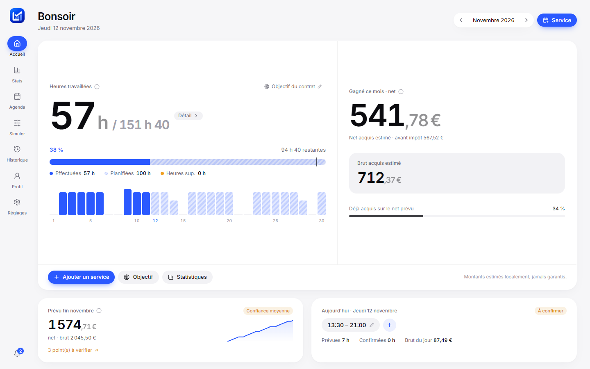
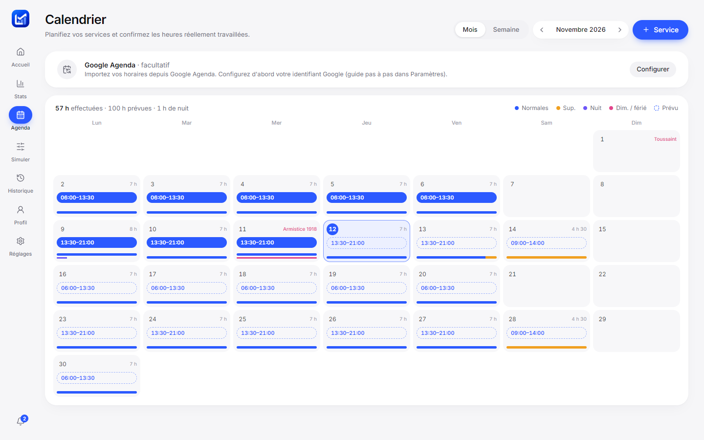
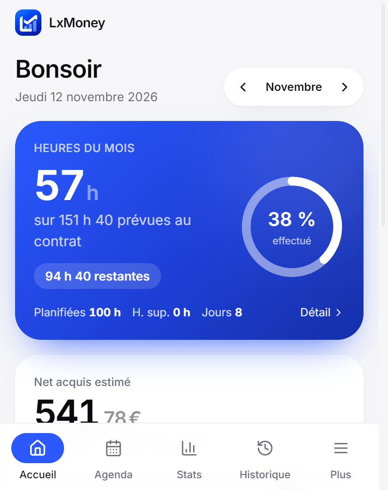
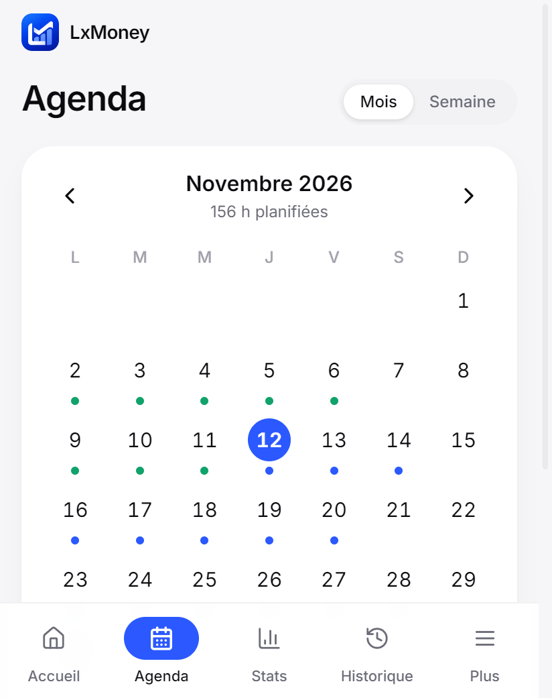

  

<h1 align="center">LxMoney</h1>

  <b>Suivez vos heures de travail et estimez votre salaire avant la fin du mois.</b> 
  Application gratuite pour <b>Windows</b> et <b>Android</b>, pensée pour les salariés en France.

  <a href="https://github.com/LxOmbre/LxMoney-Releases/releases/latest"><b>⬇ Télécharger la dernière version stable</b></a>

---

LxMoney part de vos horaires et de votre profil salarial (taux horaire, heures du contrat, primes,
majorations) pour vous dire combien d'heures vous avez faites, ce que vous avez déjà gagné et ce que
vous toucherez probablement à la fin du mois.

Pas de compte LxMoney, pas d'abonnement : vos données restent sur vos appareils, chiffrées.

> **Ce sont des estimations.** LxMoney ne remplace ni votre bulletin de paie, ni votre employeur, ni un
> conseil professionnel. Le résultat dépend des informations que vous saisissez et peut différer du
> montant réellement versé.

## Fonctionnalités

### 💶 Prévisions salariales
- Heures effectuées et heures prévues par rapport à l'objectif du contrat, en temps réel.
- Brut et net **acquis estimés** à date, et **prévision de fin de mois**.
- Pauses non payées, heures supplémentaires ou complémentaires, nuits, dimanches et jours fériés :
  les majorations s'appliquent selon les taux de **votre** profil. Elles ne sont jamais ajoutées
  d'office : vous les confirmez.
- Profil salarial saisi à la main ou importé depuis votre fiche de paie, à l'aide de l'IA de votre
  choix (copier-coller, sans clé API). Chaque valeur importée est vérifiée et vous est soumise avant
  d'être enregistrée.
- Simulateur pour tester un scénario (heures en plus, nuits…) sans toucher à vos données.

### 🗓️ Gestion des services
- Agenda mensuel et hebdomadaire : création, modification et suppression des services.
- Fiche de chaque service : horaires, durée, pause, statut, progression de la journée.
- **Validation guidée** des heures réellement travaillées. Les horaires prévus et réels sont conservés
  séparément, ce qui permet de suivre les écarts.

### 📊 Statistiques et historique
- Indicateurs et graphiques du mois ou de l'année : revenus, heures par jour, répartition des heures,
  semaines par rapport à l'objectif, prévision.
- Historique des mois terminés : estimation, net réellement reçu (si vous le renseignez) et écart.

### 📅 Google Agenda (facultatif)
- Importation de vos services depuis Google Agenda.
- Nécessite de configurer votre propre identifiant Google ; un guide pas à pas est intégré
  (Paramètres → Calendriers).

### 🔄 Synchronisation Windows ↔ Android (facultative)
- Association du téléphone au PC par **QR code**.
- Synchronisation par **Wi-Fi local** ou par **Google Drive** (dossier privé de l'application) une fois configurée.
- Données chiffrées de bout en bout. Les conflits sont signalés, rien n'est écrasé sans votre accord.

### 🔒 Sécurité des données
- Coffre **chiffré** sur chaque appareil (Android Keystore sur le téléphone), avec un **code PIN facultatif**
  pour verrouiller l'ouverture de LxMoney.
- Sauvegardes chiffrées par mot de passe, à exporter et restaurer quand vous voulez.
- Aucune donnée envoyée à l'auteur de LxMoney.

### 🔔 Notifications
- Rappels avant un service et après un service à confirmer, sous Windows et Android.
- Une notification ouvre directement le service concerné. Rien n'est affiché avant le déverrouillage.

### ⬆️ Mises à jour intégrées
- LxMoney vérifie lui-même s'il existe une nouvelle version et vous la propose, avec ses nouveautés.
- Téléchargement et installation depuis l'application (Paramètres → À propos → Mises à jour).
- Chaque mise à jour est vérifiée avant installation : manifeste signé, empreinte des fichiers et,
  sous Android, certificat de l'application. Vos données sont conservées.

## Aperçu

  

  
  &nbsp;&nbsp;
  

Captures réalisées sur une version de test avec un profil et des services entièrement fictifs.

## Télécharger et installer

Rendez-vous sur la page **[Releases](https://github.com/LxOmbre/LxMoney-Releases/releases/latest)**
et téléchargez le fichier correspondant à votre appareil. Téléchargez toujours LxMoney depuis cette page officielle.

### Windows
| Fichier | Pour qui |
| --- | --- |
| `LxMoney-Setup-<version>.exe` | Installation classique (menu Démarrer, raccourci Bureau). **Recommandé.** |
| `LxMoney-Portable-<version>.exe` | Version sans installation, à lancer directement. |

1. Lancez `LxMoney-Setup-<version>.exe`.
2. LxMoney n'est pas signé par un certificat commercial : Windows SmartScreen peut afficher
   « Windows a protégé votre ordinateur ». Cliquez sur **Informations complémentaires** → **Exécuter quand même**.
3. L'installateur détecte une installation existante et propose la mise à jour ou la réparation,
   sans toucher à vos données.

### Android
1. Téléchargez `LxMoney-Android-<version>.apk` sur votre téléphone.
2. Ouvrez le fichier et autorisez, si Android le demande, l'installation depuis votre navigateur ou
   votre gestionnaire de fichiers.
3. Les mises à jour suivantes se font depuis LxMoney (vos données sont conservées).

## Confidentialité

LxMoney fonctionne sans serveur de l'auteur. Vos données restent sur vos appareils, chiffrées. Si vous
activez Google Agenda ou Google Drive, les échanges passent par votre propre compte Google, selon les
conditions de Google (données chiffrées pour Drive).

## Licence

LxMoney est un logiciel **propriétaire gratuit** : utilisation libre et gratuite, personnelle ou
professionnelle, sans compte ni activation. La redistribution (hors lien vers cette page), la modification
et le reconditionnement sont interdits sans autorisation. Le code source n'est pas public ; ce dépôt
contient uniquement les fichiers d'installation officiels.

Conditions complètes : `LICENSE.txt` (fourni avec chaque version). Les composants libres intégrés restent
sous leurs propres licences (`THIRD-PARTY-NOTICES.txt`).

© 2026 LxOmbre.
